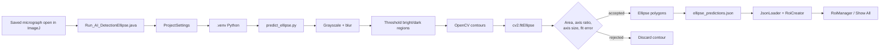
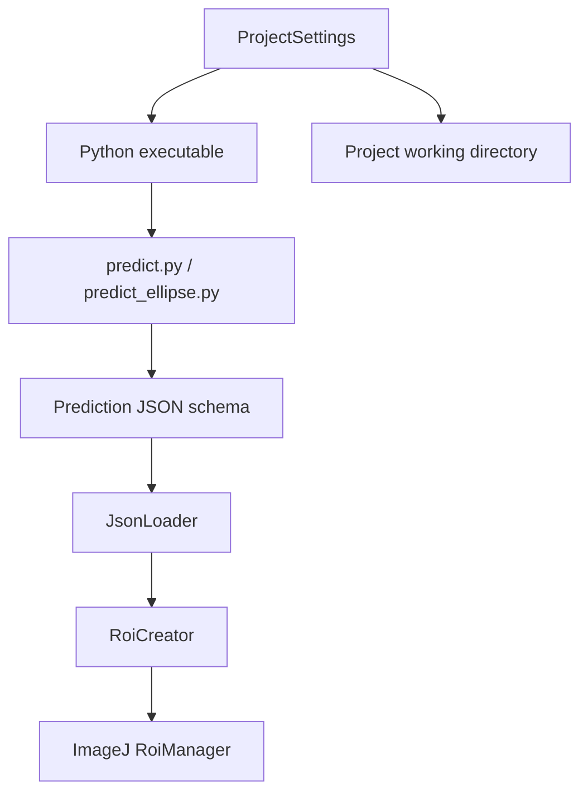

# Project diagrams

These diagrams describe the two inference paths currently implemented in the
project. They use Mermaid and can be rendered by GitHub, GitLab, and many
Markdown editors.

Native D2 source files and rendered SVGs are also provided:

- [Cellpose pipeline D2 source](cellpose_pipeline.d2) · [SVG](cellpose_pipeline.svg)
- [Ellipse pipeline D2 source](ellipse_pipeline.d2) · [SVG](ellipse_pipeline.svg)
- [Shared components D2 source](shared_components.d2) · [SVG](shared_components.svg)

## Cellpose/ImageJ pipeline

## Experimental ellipse pipeline

## Shared components

